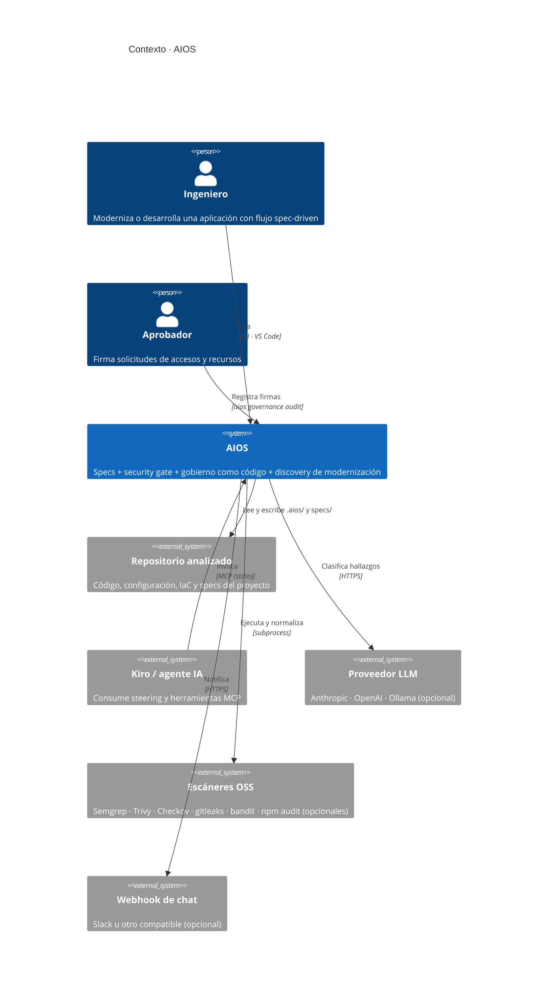
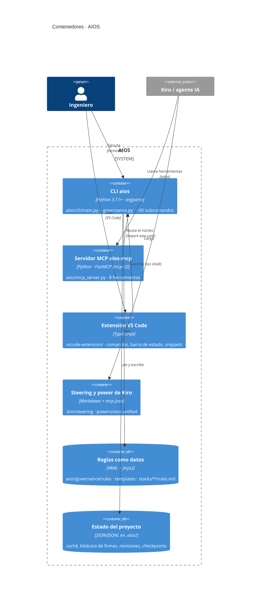
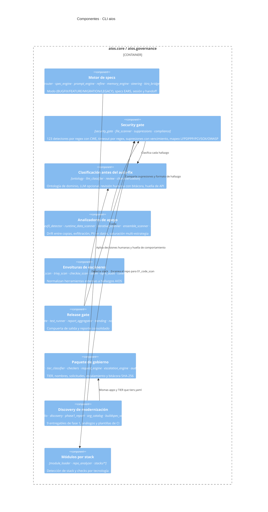
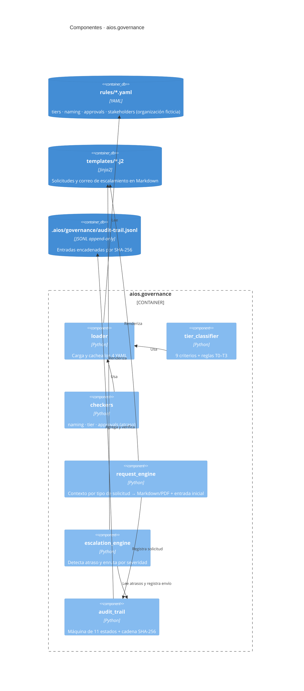

# Arquitectura · aios-framework (Dowser)

Modelo C4: contexto → contenedores → componentes. Los diagramas son texto (Mermaid) y se versionan con el
código; los nombres de componentes son módulos reales del paquete `aios`.

## 1. Contexto

## 2. Contenedores

## 3. Componentes de la CLI

## 4. Componentes del paquete de gobierno

## Decisiones

Ver [docs/adr/](../adr/): registro de decisiones (0001), detectores por regex embebidos (0002), reglas de
organización como datos de ejemplo (0003) y bitácora de firmas encadenada (0004).
